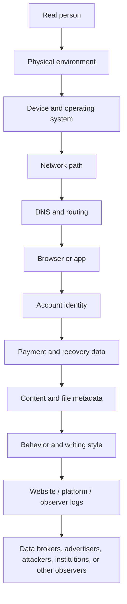
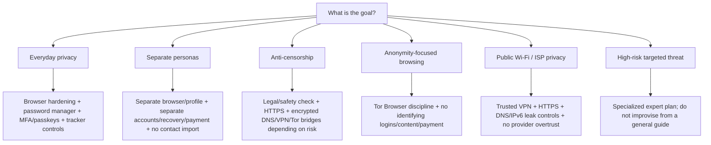

# Complete Internet Anonymity & Privacy Chain
## Institutional Educational Guide — v1.0.0

A practical, source-anchored guide to understanding how online identity leaks happen across devices, networks, browsers, accounts, payments, metadata, behavior, and platforms.

## Table of contents

- [0. One-page memory model](#0-one-page-memory-model)
- [1. Scope and ethics](#1-scope-and-ethics)
- [2. Core definitions](#2-core-definitions)
- [3. Threat-model tiers](#3-threat-model-tiers)
- [4. The complete anonymity chain](#4-the-complete-anonymity-chain)
- [5. Physical and device layer](#5-physical-and-device-layer)
- [6. Network layer](#6-network-layer)
- [7. VPNs](#7-vpns)
- [8. Proxies](#8-proxies)
- [9. Tor](#9-tor)
- [10. DNS and encrypted DNS](#10-dns-and-encrypted-dns)
- [11. Anti-censorship](#11-anti-censorship)
- [12. Browser layer: the deepest tracking surface](#12-browser-layer-the-deepest-tracking-surface)
- [13. Cookies, cache, data, and fingerprints — clear differences](#13-cookies-cache-data-and-fingerprints--clear-differences)
- [14. How major browsers handle privacy-relevant state](#14-how-major-browsers-handle-privacy-relevant-state)
- [15. Browser choice matrix](#15-browser-choice-matrix)
- [16. Account identity layer](#16-account-identity-layer)
- [17. Payment and commerce layer](#17-payment-and-commerce-layer)
- [18. Content and metadata layer](#18-content-and-metadata-layer)
- [19. Communication and secure messaging layer](#19-communication-and-secure-messaging-layer)
- [20. Behavior layer](#20-behavior-layer)
- [21. Mobile platform realities](#21-mobile-platform-realities)
- [22. Practical configurations by goal](#22-practical-configurations-by-goal)
- [23. Common failure modes](#23-common-failure-modes)
- [24. Browser data clearing guide](#24-browser-data-clearing-guide)
- [25. Institutional checklist](#25-institutional-checklist)
- [26. Glossary](#26-glossary)
- [27. Source anchors](#27-source-anchors)

---

## 0. One-page memory model

A complete anonymity chain is not one app. It is a chain of separation across every place an online action can become linked back to a person.

```text
Real person
  ↓
Physical environment
  ↓
Device and operating system
  ↓
Network path
  ↓
DNS and routing
  ↓
Browser or app
  ↓
Account identity
  ↓
Payment and recovery data
  ↓
Content and file metadata
  ↓
Behavior and writing style
  ↓
Website/platform logs
  ↓
Data brokers, advertisers, attackers, institutions, or observers
```

The most important lesson:

> A VPN can hide an IP address from a website. Tor can reduce network-level linkability. A privacy browser can reduce tracking. None of those can save you if you log into your real account, reuse your normal username, upload identifying metadata, pay with your real card, or behave exactly like your normal self.

The chain can be remembered as:

```text
PERSON → PLACE → DEVICE → NETWORK → DNS → BROWSER → ACCOUNT → PAYMENT → CONTENT → BEHAVIOR → DESTINATION
```

The shorter story is easier to remember than an acronym:

```text
Who you are, where you are, what you use, where traffic goes, what account pays or speaks, and what your content/behavior gives away.
```

GitHub-renderable layer diagram:



---

## 1. Scope and ethics

This guide is about privacy, anonymity, anti-tracking, anti-scam defense, identity protection, and censorship-resilient access to information. It is written for normal people, builders, students, journalists, activists, researchers, developers, and anyone trying to understand how internet identity leakage works.

This guide is not a guide to criminal evasion. It does not provide instructions for fraud, unauthorized access, harassment, hiding abuse, platform manipulation, malware operation, or evading lawful investigations. The same tools that protect dissidents and ordinary people from surveillance can be misused; that does not make privacy illegitimate, but it does mean privacy education must be grounded in ethics.

A defensible privacy posture has three goals:

1. **Reduce unnecessary exposure** — stop leaking data you never meant to share.
2. **Reduce unwanted tracking** — make commercial, platform, and cross-site tracking harder.
3. **Reduce identity linkage** — keep separate roles, accounts, projects, and contexts from collapsing into one profile.

NIST’s Privacy Framework treats privacy as a risk-management problem rather than a magic switch: organizations and individuals identify what data processing can create problems, then choose controls and tradeoffs appropriate to that risk.[^nist-privacy-framework]

A privacy posture should not promise perfect invisibility. The Tor Project itself says perfect anonymity is impossible, even when using Tor Browser.[^tor-best-practices] EFF’s threat-modeling guidance makes the same basic point from another angle: you decide what to protect, from whom, and what tradeoffs are worth it; you do not protect equally against every possible adversary.[^eff-security-plan]

---

## 2. Core definitions

### 2.1 Privacy

Privacy means other people, companies, networks, or platforms do not get unnecessary access to your information, behavior, messages, interests, files, accounts, device details, location, or relationships.

Privacy is about controlling exposure.

Example:

```text
You use encrypted DNS so your local network does not plainly see every domain you look up.
```

### 2.2 Security

Security means your accounts, devices, data, and communications are protected from unauthorized access, tampering, malware, credential theft, phishing, and exploitation.

Security is about preventing compromise.

Example:

```text
You use a password manager and phishing-resistant MFA so a stolen password does not become account takeover.
```

Security details matter because account takeover can collapse every privacy compartment at once. NIST SP 800-63B-4 states plainly that passwords are not phishing-resistant and recommends phishing-resistant authenticators as a mitigation for authentication threats.[^nist-800-63b-4] In normal language: passkeys and hardware security keys are usually stronger against fake-login-page attacks than SMS codes or memorized passwords alone.

### 2.3 Anonymity

Anonymity means an action cannot easily be linked to your real-world identity.

Anonymity is about separating activity from the person behind it.

Example:

```text
A website sees traffic from a Tor exit node instead of your home IP address.
```

### 2.4 Pseudonymity

Pseudonymity means activity links to a consistent persona, but not necessarily to your legal identity.

Example:

```text
A GitHub handle, forum account, or Telegram username can become a long-lived identity even if it does not show your real name.
```

Pseudonymity is not the same as anonymity. A pseudonym builds a history. That history can be linked through writing style, timing, contacts, code style, interests, payment data, reused avatars, leaked email addresses, or operational mistakes.

### 2.5 Unlinkability

Unlinkability means two actions cannot easily be proven to come from the same person or same device.

Example:

```text
A browser blocks third-party cookies, partitions site data, and reduces fingerprinting so visits to unrelated sites are harder to connect.
```

### 2.6 Identifiability

Identifiability means enough data exists to recognize, isolate, or re-identify a person, device, account, or persona.

An identifier can be obvious:

```text
name, phone number, email, IP address, credit card, shipping address
```

Or subtle:

```text
browser fingerprint, typing rhythm, writing style, timezone, device model, font list, cookie ID, recovery email, EXIF metadata
```

### 2.7 Threat model

A threat model is a clear answer to four questions:

```text
What am I protecting?
Who am I protecting it from?
How could they get it?
What tradeoffs am I willing to accept?
```

EFF defines threat modeling as deciding which potential threats to take seriously because it is impossible to protect against every trick or adversary.[^eff-threat-model]

---

## 3. Threat-model tiers

Not everybody needs the same chain. Overbuilding creates stress, breaks websites, and sometimes makes you more unique. Underbuilding creates false confidence.

### Tier 0 — Default exposed mode

This is normal internet use:

```text
Home/mobile IP + default browser + logged-in Google/Apple/Microsoft/Meta accounts + default DNS + default cookies + normal device + normal payment methods
```

This is convenient but highly linkable.

Best for:

```text
low-risk casual browsing, normal shopping, streaming, banking, school/work portals
```

Bad for:

```text
separating identities, avoiding profiling, sensitive research, avoiding targeted scams
```

### Tier 1 — Everyday privacy hardening

Goal: reduce ad tracking, scams, account compromise, and unnecessary exposure.

Common controls:

```text
password manager
unique passwords
MFA/passkeys
privacy browser or hardened browser settings
third-party cookie blocking
tracker blocking
HTTPS-only mode where available
encrypted DNS or trustworthy DNS provider
OS/app updates
basic file metadata awareness
separate browser profiles for work/personal/research
```

Best for most people.

### Tier 2 — Compartmentalized identity

Goal: keep different roles from linking together.

Common controls:

```text
separate browser profiles or separate browsers
separate emails
separate usernames
separate phone numbers where appropriate
separate cloud accounts
no shared recovery methods when separation matters
no reused avatars or bios
careful metadata handling
VPN for network-path privacy
```

Best for:

```text
creators, small business operators, researchers, activists, developers, people targeted by scams, people separating personal and public identities
```

### Tier 3 — Strong anonymity posture

Goal: reduce linkability between person, network, browser, account, and content.

Common controls:

```text
Tor Browser for web browsing
strict browser discipline
no personal logins
no reused accounts
no identifying payments
no file metadata leaks
separate device or clean OS profile where justified
consistent operational rules
minimal plugins/extensions
careful time/location/behavior separation
```

Best for:

```text
lawful high-risk research, sensitive reading, whistleblowing workflows through proper legal/organizational channels, censorship resistance, safety-sensitive speech
```

Not magic. Tor helps with network anonymity, but it does not fix bad account choices, unsafe downloads, malware, writing-style linkage, or identity-revealing content.

### Tier 4 — Institutional/high-risk operations

This tier is for trained teams with legal, safety, and operational support. It may involve dedicated devices, controlled networks, formal source-protection procedures, legal review, air-gapped evidence handling, compartmented identities, and documented operational procedures.

This guide does not attempt to fully specify Tier 4 workflows.

---

## 4. The complete anonymity chain

A complete chain has layers. Each layer answers one question: “What could link this activity back to me?”

| Layer | Linkage risk | Typical controls | Common failure |
|---|---|---|---|
| Physical environment | camera footage, location, people nearby, Wi-Fi ownership | safe location choice, awareness, no unnecessary exposure | using “anonymous” tools from a location tied to you |
| Device | hardware ID, OS account, malware, synced services | updated OS, separate profile/device, no account sync, malware prevention | using your normal phone full of logged-in apps |
| Network | IP address, ISP, carrier, local network, DNS | Tor, VPN, trusted network, encrypted DNS | thinking VPN = anonymity |
| DNS | domain lookups visible to resolver or network | DoH/DoT/ODoH, trusted resolver, Tor DNS isolation | DNS outside VPN/Tor path |
| Browser/app | cookies, cache, fingerprint, permissions, extensions | Tor Browser, privacy browser, profiles, tracker blocking | logging in or installing unique extensions |
| Account | username, email, phone, recovery, social graph | separate identity, no reuse, no linked recovery | one reused recovery email ruins separation |
| Payment | card, bank, KYC, billing, shipping | privacy-aware payment choices, no unnecessary purchases | real card links the whole chain |
| Content | EXIF, PDF author, filenames, screenshots | metadata stripping, review before upload | uploading GPS photo or author-tagged PDF |
| Behavior | writing style, schedule, interests, errors | persona discipline, schedule awareness | same slang, same hours, same topics |
| Destination | platform logs, tracking pixels, captchas, fraud systems | minimize trust, understand platform visibility | destination sees identity anyway |

The strongest chain is only as strong as its weakest necessary link. If you hide your IP but reveal your phone number, the network layer succeeded and the account layer failed.

---

## 5. Physical and device layer

### 5.1 Physical-world linkage

Internet activity often has physical-world anchors:

```text
home internet account
mobile carrier account
public Wi-Fi location
camera footage
store purchase logs
work/school network logs
GPS and cell tower history
Bluetooth and Wi-Fi scanning
package delivery address
```

A “private” online session is not fully private if it is performed from a place, network, or device that is already strongly tied to you.

### 5.2 Device identity

Your device can leak identity through:

```text
OS version
hardware model
screen size
GPU/graphics behavior
installed fonts
installed browser extensions
language and timezone
battery/sensor APIs
cloud account sync
advertising IDs
push notification tokens
logged-in apps
malware or spyware
```

On phones, the device layer is especially hard to separate because the phone is tied to a carrier, SIM/eSIM, app store account, location services, push notification infrastructure, contacts, photos, messaging apps, Bluetooth, Wi-Fi, and cloud backups.

### 5.3 Separate profile vs separate browser vs separate device

| Separation method | Strength | Usability | Best use |
|---|---:|---:|---|
| Separate browser profile | low/medium | high | keeping work/personal/research cookies apart |
| Separate browser | medium | high | avoiding casual cross-contamination |
| Separate OS user account | medium/high | medium | stronger separation on Windows/macOS/Linux |
| Separate device | high | low/medium | high-risk identity separation |
| Live OS / ephemeral session | high but easy to misuse | low | controlled special-purpose sessions |

Most people should start with separate browser profiles and good account hygiene. Jumping straight to exotic setups without discipline creates theater, not privacy.

---

## 6. Network layer

### 6.1 What the network layer reveals

Without special controls, your internet path can reveal:

```text
public IP address
ISP or mobile carrier
rough location
DNS queries
connection times
amount of traffic
server IPs contacted
TLS metadata such as SNI in many cases unless encrypted client hello is used and supported
```

HTTPS protects content in transit, but it does not hide everything. A local observer may still see that you connected to a given IP address, when, and how much data moved. DNS may reveal domain names unless encrypted and properly routed.

### 6.2 IP address

Your IP address is not your full identity, but it is often enough to infer:

```text
ISP or carrier
rough city/region
home/business/mobile connection type
VPN/proxy/Tor usage
network reputation
```

A website can log IP address. A platform can combine IP with account login, cookies, device fingerprint, payment, behavior, and message content.

### 6.3 DNS

DNS is the internet’s naming system. When your device wants `example.com`, DNS resolves the human-readable name into network addresses.

Plain DNS traditionally travels unencrypted. Encrypted DNS variants include:

```text
DoH — DNS over HTTPS
DoT — DNS over TLS
DoQ — DNS over QUIC
ODoH — Oblivious DNS over HTTPS, where supported
```

Cloudflare describes DoH as sending DNS queries as HTTPS requests so parties between your device and resolver cannot see the domain lookups.[^cloudflare-doh] Cloudflare describes DoT as DNS over an encrypted TLS connection on port 853.[^cloudflare-dot] Quad9 is a public DNS resolver that can block lookups of malicious hostnames using threat intelligence.[^quad9]

Important: encrypted DNS does not make you anonymous. It shifts trust from the local network/ISP toward the resolver and can still leave other metadata visible.

### 6.4 DNS leak

A DNS leak happens when your traffic uses one privacy path but your DNS queries go somewhere else.

Examples:

```text
browser traffic goes through VPN, DNS still goes to ISP
app traffic goes through proxy, DNS resolves locally
Tor Browser is used correctly, but another app on the device leaks activity outside Tor
```

Tor Browser handles DNS for browser activity through Tor. System-wide VPN/proxy setups need leak protection if DNS privacy matters.

### 6.5 IPv6 leak

An IPv6 leak happens when part of your traffic uses one privacy path while IPv6 traffic exits another path directly. This can happen when a VPN, proxy app, firewall, or operating-system configuration handles IPv4 correctly but leaves IPv6 untouched. The result can be worse than no privacy tool because the user believes traffic is protected while some destinations still see the normal network address.

Practical meaning:

```text
IPv4 traffic → VPN tunnel
IPv6 traffic → normal ISP/mobile connection
```

What to check:

```text
Does the VPN support IPv6 inside the tunnel, or does it block IPv6 while connected?
Does the kill switch block traffic when the tunnel drops?
Do DNS leak tests and IPv6 leak tests agree after reconnects, sleep/wake, and network changes?
Do mobile apps bypass the browser/VPN path?
```

A DNS leak exposes lookups. An IPv6 leak can expose direct network routing. They are related but not the same failure.

---

## 7. VPNs

### 7.1 What a VPN does

A VPN creates an encrypted tunnel between your device and the VPN provider. To your local network or ISP, your traffic appears to go to the VPN server. To websites, your connection appears to come from the VPN server’s IP address.

A VPN can help with:

```text
hiding destination details from local Wi-Fi observers
hiding many browsing destinations from ISP/mobile carrier
masking your home/mobile IP from websites
reducing exposure on hostile public Wi-Fi
accessing resources through another region, where lawful and allowed
```

### 7.2 What a VPN does not do

A VPN does not automatically prevent:

```text
tracking by logged-in accounts
tracking by cookies
browser fingerprinting
malware on your device
payment linkage
file metadata leaks
IPv6 or WebRTC leaks when the client/browser is poorly configured
behavioral linkage
tracking by the VPN provider itself
tracking by the destination website
```

A VPN changes who can see parts of your traffic. It does not erase trust. Instead of trusting only your ISP, you now also trust the VPN provider.

### 7.3 VPN trust questions

Before trusting a VPN, ask:

```text
Who operates it?
What jurisdiction is it under?
What logs does it keep?
Has the no-logs claim been independently audited?
Does it support kill switch / always-on behavior?
Does it prevent DNS leaks?
Does it prevent IPv6 leaks by tunneling or blocking IPv6?
Does it support WireGuard or another modern protocol?
Does it require personal payment details?
Does it work on your platform without weird permissions?
```

### 7.4 Free VPN caution

Free VPNs can be legitimate, but “free” services often monetize through ads, data collection, bandwidth resale, weak security, or aggressive upsells. A free VPN from a reputable provider with a clear privacy model is different from a random free VPN app with unclear ownership.

Rule:

```text
A bad VPN is worse than no VPN because it gives you false confidence while centralizing your traffic in an untrusted party.
```

### 7.5 VPN and Tor

The Tor Project generally does not recommend combining VPNs with Tor unless the user is advanced enough to configure both without compromising privacy.[^tor-vpn] This is important because many people assume “VPN + Tor = double anonymous.” In reality, bad combinations can add complexity, break Tor protections, or create new trust assumptions.

Common models:

| Model | Path | Meaning |
|---|---|---|
| Tor only | You → Tor → destination | Tor hides your IP from destination; ISP sees Tor use unless bridges are used |
| VPN only | You → VPN → destination | website sees VPN IP; VPN sees your real IP and destination metadata |
| VPN then Tor | You → VPN → Tor → destination | ISP sees VPN; VPN sees Tor connection; Tor still provides Tor path to destination |
| Tor then VPN | You → Tor → VPN → destination | usually not recommended for normal users; VPN becomes destination-side identity and may defeat Tor benefits |

For most users who need Tor, use Tor Browser correctly. If Tor is blocked, use bridges or pluggable transports before assuming a VPN stack is better.

---

## 8. Proxies

### 8.1 What a proxy is

A proxy is an intermediary server that forwards traffic for a client. It can hide your direct IP from the destination for traffic that actually uses the proxy.

Common types:

```text
HTTP proxy — for HTTP/HTTPS web traffic through browser or app configuration
SOCKS proxy — lower-level proxy that can handle many TCP applications
transparent proxy — network/operator proxy you may not explicitly configure
reverse proxy — server-side proxy in front of a website or application
residential proxy — proxy using residential IP ranges, often ethically and legally sensitive depending on sourcing
mobile proxy — proxy using mobile carrier IP ranges, also sensitive depending on sourcing
```

### 8.2 Proxy vs VPN

| Feature | Proxy | VPN |
|---|---|---|
| Scope | often per-app | often system-wide |
| Encryption | depends on protocol and destination | tunnel is encrypted to VPN provider |
| DNS handling | easy to leak if misconfigured | usually provider-controlled if configured well |
| Authentication | often username/password/IP allowlist | account/app/certificate/profile |
| Privacy trust | proxy operator sees metadata | VPN operator sees metadata |
| Common use | routing specific apps, testing, corporate gateways | general network privacy, public Wi-Fi, IP masking |

### 8.3 Proxy risks

A proxy can:

```text
log requests
inject ads or malware if plaintext traffic is used
steal credentials if TLS is broken or user ignores certificate warnings
leak DNS if the app resolves locally
fail open if the proxy disconnects
carry a bad reputation that causes blocks and captchas
```

Rule:

```text
Do not send sensitive traffic through random proxies. Treat proxy operators like network operators.
```

### 8.4 Proxy legitimacy

Proxies have legitimate uses:

```text
corporate access control
load testing on owned systems
web compatibility testing
privacy routing for specific apps
research on censorship and reachability
API egress management
```

They also have abuse associations because they are used for spam, credential attacks, scraping abuse, ban evasion, and fraud. Reputation matters. Using suspicious proxy pools can get accounts flagged even if your intent is harmless.

---

## 9. Tor

### 9.1 What Tor is

Tor is a free, open network designed to defend privacy and enable anonymous communication. The Tor Project describes its mission as advancing human rights and defending privacy online through free software and open networks.[^tor-project]

Tor Browser is the normal user-facing way to browse the web through Tor. It is available for Windows, macOS, Linux, and Android.[^tor-install] Tor Browser for Android is the official Tor mobile browser supported by the Tor Project.[^tor-android]

On iOS/iPadOS, there is no full Tor Browser equivalent with the same protections as desktop/Android Tor Browser. Apple documents alternative browser-engine entitlements for EU users under specific conditions, but outside those special EU paths, iOS browser behavior is still heavily shaped by Apple’s platform rules.[^apple-alt-engines] Onion Browser and Orbot can be relevant on iOS, but they should not be treated as identical to Tor Browser on desktop or Android.[^guardian-onion-browser]

### 9.2 How Tor works conceptually

Tor routes traffic through a circuit of relays. A simplified web circuit is:

```text
You → entry/guard relay → middle relay → exit relay → destination website
```

Each relay knows only part of the path:

| Relay | Knows | Does not know |
|---|---|---|
| Entry/guard | your IP and next Tor relay | final destination content/domain in normal web case |
| Middle | previous and next Tor relay | you and final destination |
| Exit | destination and outgoing traffic metadata | your real IP |

This separation is the point. No single relay should know both who you are and where you are going.

### 9.3 What Tor protects

Tor Browser can help protect against:

```text
websites seeing your real IP
local network seeing the websites you browse through Tor
cross-site tracking through normal browser state
some forms of browser fingerprinting
censorship of ordinary direct access, especially with bridges/transports
```

Tor Browser includes anti-fingerprinting defenses such as letterboxing, user-agent spoofing, and other techniques intended to make users look more alike.[^tor-fingerprinting]

### 9.4 What Tor does not protect

Tor does not protect you from:

```text
logging into identifying accounts
revealing your identity in messages
downloading and opening unsafe files outside Tor isolation
malware on your device
browser zero-days
payment and shipping linkage
typing/writing-style linkage
traffic correlation by powerful observers
unsafe plugins or external apps
```

Tor is a network anonymity tool plus hardened browser. It is not a total identity-erasure machine.

### 9.5 Tor Browser security levels

Tor Browser has security levels: Standard, Safer, and Safest. The Tor Project explains that higher levels disable or restrict some web features, including JavaScript and media behaviors, to reduce attack surface at the cost of website functionality.[^tor-security-levels]

| Level | Usability | Security posture | Practical meaning |
|---|---:|---:|---|
| Standard | highest | baseline Tor protections | most sites work; JavaScript enabled |
| Safer | medium | stronger | some risky features restricted; some sites break |
| Safest | lowest | strongest | mostly static/basic sites; many modern sites break |

Memory hook:

```text
Higher Tor security = fewer web features = fewer attack surfaces = more broken websites.
```

### 9.6 Bridges

A Tor bridge is a Tor relay that is not publicly listed in the same way as ordinary relays. Bridges help people connect when direct Tor access is blocked. Tor’s bridge site describes bridges as relays that help circumvent censorship.[^tor-bridges]

Use bridges when:

```text
Tor is blocked by your network
Tor connections are throttled or reset
you do not want the local network to easily see direct Tor relay connections
```

### 9.7 Pluggable transports

Pluggable transports make Tor traffic look different so censors have a harder time blocking it.

Common examples include:

```text
obfs4
Snowflake
WebTunnel
meek-style/domain-fronting systems where still supported
```

Tor support says Snowflake is a built-in pluggable transport that lets users on censored networks connect to Tor through volunteer-run proxies.[^tor-snowflake] The Snowflake project describes the technique as disguising Tor activity as though it were a video or voice call by using WebRTC-like behavior, but this is still an anti-censorship arms race rather than a guarantee that every censor will be fooled forever.[^tor-snowflake-site]

### 9.8 Onion services

Onion services are sites or services reachable through `.onion` addresses. They can provide:

```text
server-location privacy
end-to-end routing inside Tor
self-authenticating onion addresses
censorship resistance
```

But onion services are not automatically trustworthy. A scam site on an onion address is still a scam site. A phishing onion address can still steal credentials. An onion URL is a routing/privacy property, not a moral certificate.

### 9.9 Tor Browser discipline rules

For lawful privacy use:

```text
Use Tor Browser as downloaded from the official source.
Do not install random extensions.
Do not resize/customize aggressively if fingerprinting resistance matters.
Do not log into personal accounts when anonymity is the goal.
Do not mix anonymous and normal browsing in the same session.
Do not open downloaded documents outside a safe workflow if metadata or network callbacks matter.
Use higher security levels when visiting untrusted or high-risk sites.
Use bridges/transports if direct Tor is blocked.
Keep Tor Browser updated.
```

### 9.10 Tor performance and user experience

Tor is usually slower than normal browsing or VPN browsing because traffic travels through multiple relays and because Tor Browser restricts or standardizes some browser behaviors. Some websites block Tor exit nodes, show more CAPTCHAs, or deny access. That is a usability cost, not proof Tor is broken.

### 9.11 Tor VPN beta caution

The Tor Project has documented Tor VPN as beta software and warns not to rely on it for sensitive use because it may leak information.[^tor-vpn-beta] Tor VPN Beta is still relevant to understand because it sits between the categories that people often confuse: it uses Android’s VPN interface to route selected app traffic through Tor rather than acting like a normal commercial VPN, and Tor’s current censorship guidance lists Tor VPN Beta among tools supporting WebTunnel bridges in censored regions.[^tor-censored-regions] That makes it an important anti-censorship development, not a reason to treat beta software as mature protection for sensitive work. This guide treats Tor Browser as the mature default Tor user tool.

---

## 10. DNS and encrypted DNS

### 10.1 What DNS can reveal

DNS lookups can reveal:

```text
which domains you visit
when you visit them
which device/network asked
which resolver you use
patterns of app behavior
```

Even if the page content is encrypted with HTTPS, DNS can expose the domain request unless DNS is encrypted and routed properly.

### 10.2 Resolver choice

Your resolver may be:

```text
ISP default DNS
mobile carrier DNS
router-configured DNS
browser-selected DoH resolver
VPN provider DNS
public resolver such as Cloudflare, Google, Quad9, NextDNS, Control D, AdGuard DNS, etc.
self-hosted resolver
```

Resolver choice is a trust decision. A privacy-respecting resolver can reduce ISP visibility. A bad resolver can log or manipulate queries.

### 10.3 DoH vs DoT vs VPN DNS

| Method | Protects from local network seeing DNS? | Hides DNS from resolver? | Notes |
|---|---:|---:|---|
| Plain DNS | no | no | default legacy behavior |
| DoH | yes | no | DNS inside HTTPS to resolver |
| DoT | yes | no | DNS over TLS to resolver |
| ODoH | yes | partially | separates client IP from query content when properly implemented |
| VPN DNS | from local network/ISP | no, VPN/resolver sees | depends on VPN design |
| Tor Browser DNS | yes for Tor Browser use | Tor path separates user from destination | use Tor Browser, not random system DNS hacks |

### 10.4 DNS is not enough

Encrypted DNS does not hide:

```text
IP addresses you connect to
traffic timing
traffic volume
browser fingerprint
authenticated account identity
cookies
payment data
```

Encrypted DNS is a privacy layer, not an anonymity chain.

---

## 11. Anti-censorship

### 11.1 Censorship mechanisms

Internet censorship can happen through:

```text
DNS blocking or poisoning
IP blocking
SNI/TLS filtering
HTTP keyword filtering on plaintext traffic
deep packet inspection
app store restrictions
platform bans
throttling
network shutdowns
captive portals
legal pressure on providers
```

### 11.2 Circumvention tool categories

| Tool | Main purpose | Strength | Weakness |
|---|---|---|---|
| HTTPS | protects content integrity/confidentiality | universal | does not hide domain/IP by itself |
| Encrypted DNS | prevents local DNS snooping/tampering | simple | not full circumvention |
| VPN | alternate route through VPN server | usable | provider trust, blocking, logging |
| Tor | anonymity + censorship resistance | strong privacy model | slower, blocked by some sites/networks |
| Tor bridges | unblock Tor when direct Tor is blocked | strong | bridges can be discovered/blocked |
| Pluggable transports | disguise Tor traffic | strong against some censors | arms race |
| Web proxy | quick blocked-site access | easy | weak privacy/security; proxy sees traffic |
| Psiphon/Lantern-style tools | censorship circumvention | practical in some regions | trust/model varies by tool |
| OONI Probe | measurement, not circumvention itself | evidence | measurements can be sensitive in some regions |

EFF’s censorship-circumvention guide describes web-based proxies as one method for accessing blocked sites, while Tor and VPN-style tools represent other approaches.[^eff-circumvention]

OONI Explorer is an open data resource for investigating internet censorship around the world, with measurements contributed from many networks and countries.[^ooni]

### 11.3 Anti-censorship risk

In some countries or institutions, using circumvention tools may itself create risk. The right tool depends on local law, local enforcement, threat model, and safety context. Do not assume the technical best tool is the safest personal choice.

---

## 12. Browser layer: the deepest tracking surface

The browser is often the most important privacy battleground because it sits between you and nearly every website. It stores state, exposes device details, runs JavaScript, manages logins, handles downloads, accepts permissions, and executes untrusted code from the web.

The browser layer has two big tracking categories:

```text
stateful tracking — the site stores or retrieves an identifier
stateless tracking — the site recognizes your browser/device from its characteristics
```

Cookies are stateful. Fingerprinting is mostly stateless. Modern tracking often combines both.

MDN describes browser fingerprinting as identifying a browser by collecting and combining distinguishing features of the browser and operating system.[^mdn-fingerprinting]

---

## 13. Cookies, cache, data, and fingerprints — clear differences

### 13.1 The simple comparison

| Term | What it is | Who uses it | Persists? | Main risk |
|---|---|---|---|---|
| Cookie | small site-set value sent with requests | websites/trackers | yes, unless session cookie or cleared | login/session tracking, cross-site tracking |
| Cache | saved copies of files/responses | browser/sites | yes, controlled by cache rules | history clues, cache-based tracking, stale data |
| Site data | umbrella for storage tied to sites | web apps | yes | persistent identifiers and offline data |
| localStorage | JavaScript key-value storage | web apps/scripts | across sessions | persistent tracking values |
| sessionStorage | tab/session key-value storage | web apps/scripts | until tab/session ends | session tracking |
| IndexedDB | browser database | complex web apps | yes | large persistent storage |
| Cache API | script-managed request/response cache | PWAs/service workers | yes | offline persistence, tracking surface |
| Service worker | background script for a site | PWAs/sites | yes until removed | background fetch/push/cache behavior |
| History | list of visited pages | browser/user | yes unless private/cleared | local privacy, forensic/history exposure |
| Autofill | saved forms/addresses/cards | browser/user | yes | accidental identity disclosure |
| Fingerprint | derived identifier from characteristics | trackers/fraud systems/sites | can persist without storage | tracking even after clearing cookies |

MDN’s client-side storage documentation names cookies, Web Storage, IndexedDB, and Cache API as key browser storage technologies used for state, personalization, and offline work.[^mdn-client-storage]

### 13.2 Cookies

A cookie is a small piece of data a website stores in the browser. Cookies are sent back to the relevant site with future requests. MDN notes that cookies were historically used for general client-side storage, but modern APIs such as Web Storage and IndexedDB are now recommended for storage because cookies are sent with requests and have drawbacks.[^mdn-cookies]

Common cookie types:

| Type | Meaning |
|---|---|
| Session cookie | intended to disappear after the session ends |
| Persistent cookie | remains until expiration or deletion |
| First-party cookie | set by the site you are visiting |
| Third-party cookie | set by another domain embedded in the page |
| Secure cookie | sent only over HTTPS |
| HttpOnly cookie | not accessible to JavaScript, useful against some XSS theft |
| SameSite cookie | limits cross-site sending behavior |
| Partitioned cookie | scoped by top-level site context in newer privacy models |

Cookies can be necessary:

```text
staying logged in
shopping carts
language settings
security tokens
fraud prevention
```

Cookies can also track:

```text
ad identifiers
analytics identifiers
cross-site behavior
affiliate/referral journeys
session stitching
```

### 13.3 Cache

Cache stores copies of web resources so pages load faster and use less data.

Examples:

```text
images
CSS files
JavaScript files
font files
API responses
HTML pages
```

MDN describes HTTP cache as storing a response associated with a request and reusing it for later requests.[^mdn-http-cache] Cache-Control headers tell browsers and shared caches how caching should behave.[^mdn-cache-control]

Cache is not the same as cookies:

```text
Cookie = small identifier/state value sent to server.
Cache = saved content/resource copy reused for performance.
```

Privacy issue: cache can reveal what sites/resources were loaded, and some tracking techniques can abuse cache behavior.

### 13.4 Site data

“Site data” is an umbrella term browsers use for data stored by websites. It can include:

```text
cookies
localStorage
sessionStorage
IndexedDB
Cache API storage
service worker registrations
permissions
persistent file-system-like data in some browsers
```

Clearing “cookies” may not clear all site data depending on browser and setting. Clearing “site data” is broader.

### 13.5 localStorage and sessionStorage

Web Storage gives sites key-value storage in the browser. MDN describes Web Storage as a more intuitive key-value storage mechanism than cookies.[^mdn-web-storage]

| Storage | Lifetime | Sent with every request? | Typical use |
|---|---|---:|---|
| localStorage | persists across browser sessions | no | preferences, app state, identifiers |
| sessionStorage | lasts for tab/session | no | temporary workflow state |
| cookies | expiration/session-based | yes, to matching site | sessions, auth, tracking |

Privacy issue: localStorage can hold persistent IDs that survive until cleared.

### 13.6 IndexedDB

IndexedDB is a browser database for structured data. It is used by web apps that need more complex or larger client-side storage.

Common uses:

```text
offline apps
large cached datasets
webmail state
notes/apps/editors
progressive web apps
```

Privacy issue: it can store large amounts of persistent site data.

### 13.7 Cache API and service workers

Service workers are background scripts that allow websites to intercept requests, cache content, support offline use, and implement push-like web app behaviors. The Cache API stores request/response pairs for service workers and progressive web apps.

Privacy issue: service workers and Cache API can persist beyond a normal tab and create unexpected site behavior if not cleared.

### 13.8 History, downloads, autofill, passwords

These are not cookies, but they can expose identity locally.

| Data | Privacy issue |
|---|---|
| History | reveals pages visited on the device |
| Download history | reveals downloaded filenames/sources |
| Bookmarks | reveal interests/accounts/projects |
| Autofill | may insert real name, phone, address, email |
| Saved passwords | tie account names to browser profile |
| Payment autofill | exposes card/billing identity |

Private/incognito modes mostly target local history and session state. They do not make you anonymous to websites, ISPs, employers, schools, or platforms.

### 13.9 Fingerprinting

Fingerprinting tries to recognize your browser/device without needing a stored cookie.

Signals can include:

```text
User-Agent / browser version
platform and OS
screen size and color depth
window size
language/locale
timezone
installed fonts
canvas rendering
WebGL/GPU behavior
audio processing behavior
hardware concurrency / CPU hints
memory hints
battery/sensor APIs where exposed
media devices
touch support
extension behavior
ad blocker behavior
TLS/client handshake properties
HTTP header ordering
IP address and network reputation
behavioral signals such as mouse/typing patterns
```

Fingerprinting is hard to prevent because many signals have legitimate uses. If a browser blocks everything, websites break. If it exposes everything, tracking gets easier.

### 13.10 Why clearing cookies is not enough

Clearing cookies can remove stored identifiers, but it does not automatically change:

```text
IP address
browser fingerprint
device fingerprint
account login
localStorage if not cleared
IndexedDB if not cleared
service worker data if not cleared
writing style
behavior pattern
payment linkages
```

Modern trackers may combine cookies, local storage, first-party scripts, fingerprinting, IP reputation, and account data. First-party tracking can remain powerful even when third-party cookies are restricted.

### 13.11 Private/incognito mode

Private browsing usually means:

```text
local history not saved after private session
cookies/site data from private session cleared when session closes
separate temporary session from normal windows
some tracker protections may be stronger depending on browser
```

It usually does not mean:

```text
websites cannot see your IP
websites cannot fingerprint you
employer/school/ISP cannot see network activity
logged-in services cannot track you
malware cannot record activity
files/bookmarks are automatically erased
```

Firefox says Private Browsing erases browsing history and tracking cookies from websites visited after the last private window is closed,[^firefox-private] and Mozilla’s support guidance separately warns that Private Browsing does not make a user anonymous, hide activity from an ISP, mask IP address/location, or stop websites from identifying or tracking the user.[^firefox-private-myths] Microsoft says Edge InPrivate does not save history, cookies, site data, passwords, addresses, form data, images/files cache, or site permissions to the browser after the session.[^edge-inprivate] Apple says Safari Private Browsing on iPhone does not remember pages visited, search history, or AutoFill information, and adds protections against known trackers and advanced fingerprinting techniques.[^safari-private-iphone]

---

## 14. How major browsers handle privacy-relevant state

Important: browser behavior changes over time. This section was last reviewed in July 2026 and should be rechecked when browser policies, platform rules, or privacy features change.

### 14.1 Chrome

Strengths:

```text
fast
high compatibility
strong sandbox/security engineering
frequent updates
widely supported on Windows, macOS, Linux, Android, iOS/iPadOS
```

Privacy concerns:

```text
Google ecosystem integration
advertising-business incentives
third-party cookie policy has shifted over time
Privacy Sandbox/IP Protection roadmap was retired after earlier announcements
Manifest V3 limits some extension-based content-blocking approaches
user must actively manage many privacy controls
fingerprinting resistance is not as anonymity-focused as Tor Browser
```

Google’s Chrome help explains users can delete cookies, allow/block third-party cookies, and set site-specific preferences.[^chrome-cookies] The Chrome privacy roadmap must be treated carefully: Google’s April 2025 post said Chrome would keep the existing user-choice approach to third-party cookies and continue enhancing Incognito protections,[^google-privacy-sandbox-next] but Google later retired multiple Privacy Sandbox technologies, including IP Protection, Attribution Reporting API, Private Aggregation, Protected Audience, Topics, and related proposals.[^google-privacy-sandbox-retire] For this guide, the safe reader-facing rule is: do not choose Chrome because you assume a future Privacy Sandbox feature will protect you. Choose Chrome for compatibility and manage privacy controls deliberately.

Extension note: Chrome’s Manifest V2 phase-out means the original full uBlock Origin extension is not a normal current Chrome path. Google’s own timeline says Chrome 138 was the final version supporting Manifest V2 with enterprise policy and Chrome 139 removed support broadly,[^chrome-mv2-timeline] while the uBlock Origin project says uBO is a Manifest V2 extension and uBO Lite is a pared-down Manifest V3-compatible alternative that cannot silently replace it.[^ublock-chrome-mv3]

Best fit:

```text
maximum compatibility, banking/work/school portals, Google-heavy workflows
```

Not best fit:

```text
strong anti-tracking by default, anonymity, de-Googled workflows
```

### 14.2 Microsoft Edge

Strengths:

```text
Chromium compatibility
Windows integration
enterprise controls
tracking prevention settings
security features
```

Privacy concerns:

```text
Microsoft account integration
Windows telemetry ecosystem
shopping/recommendation features may not fit strict privacy goals
```

Microsoft says Edge tracking prevention detects and blocks potentially harmful trackers, including cryptomining and fingerprinting trackers.[^edge-tracking] Microsoft developer documentation says Edge tracking prevention restricts trackers’ access to browser-based storage and the network.[^edge-tracking-dev]

Best fit:

```text
Windows users who need compatibility and enterprise/work integration
```

Not best fit:

```text
strong identity separation from Microsoft ecosystem unless carefully configured
```

### 14.3 Firefox

Strengths:

```text
independent browser engine on desktop/Android
Enhanced Tracking Protection
Total Cookie Protection / cookie partitioning approach
strong extension ecosystem on desktop
about:config/customization for advanced users
```

Privacy concerns:

```text
custom over-hardening can make you unique
some hardened settings break sites
privacy varies by platform and configuration
```

Mozilla says Firefox Enhanced Tracking Protection blocks trackers that follow users around online.[^firefox-etp] Mozilla announced Total Cookie Protection by default in 2022, describing it as confining cookies to the site where they were created to reduce cross-site tracking.[^firefox-tcp] Firefox is also important in the 2026 browser-choice conversation because it remains a practical home for full uBlock Origin-style extension blocking where Chrome has moved to Manifest V3 constraints.[^ublock-chrome-mv3]

Best fit:

```text
privacy-conscious daily browsing, Windows/Linux/macOS/Android users who want strong controls without Tor-level friction
```

Not best fit:

```text
maximum site compatibility with no tuning, high-anonymity use where Tor Browser is the correct tool
```

### 14.4 Brave

Strengths:

```text
tracker/ad blocking by default
fingerprinting defenses
Chromium compatibility
available across major platforms
private search option
```

Privacy concerns:

```text
crypto/wallet/ad-reward features may be unwanted by some users
Chromium base means some Google web platform assumptions still apply
some sites break due to aggressive blocking
```

Brave describes itself as a free, open-source, Chromium-based browser with privacy protections and availability on desktop, Android, and iOS.[^brave] Brave Shields are built into the browser and are described by Brave as blocking trackers, cross-site cookies, phishing, fingerprinting, and more.[^brave-shields] Native blocking matters because it is less dependent on the exact Chrome extension model than an add-on-only workflow.

Best fit:

```text
easy privacy-by-default daily browser, especially for users who want less configuration
```

Not best fit:

```text
Tor-level anonymity; Brave private windows with Tor are not a replacement for Tor Browser
```

### 14.5 Safari

Strengths:

```text
excellent Apple platform integration
Intelligent Tracking Prevention
strong battery/performance on Apple hardware
Private Browsing improvements
cross-site tracking protections
```

Privacy concerns:

```text
Apple ecosystem tie-in
limited extension model compared to desktop Chromium/Firefox
browser engine constraints on iOS/iPadOS affect third-party browser diversity
```

Apple says Safari limits third-party cookies and data by default on iPhone when Prevent Cross-Site Tracking is enabled.[^safari-iphone-privacy] Apple’s Safari page says Safari includes Intelligent Tracking Prevention to identify trackers and help prevent profiling/following across the web.[^apple-safari]

Best fit:

```text
Apple users who want strong default privacy with smooth usability
```

Not best fit:

```text
cross-platform uniformity, advanced extension-heavy workflows, Tor-equivalent anonymity
```

### 14.6 DuckDuckGo browser

Strengths:

```text
simple privacy-first defaults
tracker blocking
private search integration
Fire button / easy clearing model
Android App Tracking Protection feature
```

Privacy concerns:

```text
less advanced customization than Firefox/Brave
platform capabilities vary
not an anonymity network
```

DuckDuckGo describes its browser as including tracker blocking, increased encryption, email protection, and privacy protections by default.[^ddg-browser] DuckDuckGo says its Android App Tracking Protection helps block third-party trackers in apps even when not using those apps.[^ddg-app-tracking]

Best fit:

```text
nontechnical users who want simple privacy defaults
```

Not best fit:

```text
highly customized research workflows or Tor-level anonymity
```

### 14.7 Tor Browser

Strengths:

```text
best mainstream browser for network anonymity
anti-fingerprinting design
Tor routing built in
state isolation
censorship circumvention with bridges/transports
```

Privacy concerns / costs:

```text
slower
sites break or block Tor
CAPTCHAs are common
personal logins defeat anonymity goals
not available as equivalent official Tor Browser on iOS
```

Best fit:

```text
sensitive browsing, anti-censorship, anonymity-focused web use
```

Not best fit:

```text
daily banking/shopping/work portals, accounts that already know your identity, high-performance streaming
```

### 14.8 Mullvad Browser

Mullvad Browser is a Tor Project/Mullvad collaboration intended to bring Tor Browser-like anti-fingerprinting concepts to non-Tor browsing, often paired with a VPN. Tor Project support describes Mullvad Browser as free and open-source software that can be used with or without a VPN, while warning that users should trust their VPN provider if they use one.[^mullvad-browser]

Best fit:

```text
users who want anti-fingerprinting without routing through Tor
```

Not best fit:

```text
users who need Tor network anonymity itself
```

### 14.9 LibreWolf

LibreWolf is a Firefox-based browser project focused on privacy, security, and user freedom. The project says it aims to increase protection against tracking and fingerprinting while removing telemetry, data collection, and related annoyances.[^librewolf]

Best fit:

```text
advanced desktop users who want a hardened Firefox-family browser without manually building a custom about:config profile
```

Not best fit:

```text
users who need maximum compatibility, managed enterprise support, or mobile parity across Android/iOS
```

Key warning: hardened defaults are useful, but they are not magic. If you log into identifying accounts, use unique behavior patterns, or add unusual extensions, you can still create linkage.

### 14.10 Vivaldi

Vivaldi is a Chromium-based browser with extensive customization and built-in tracker/ad blocking options. Vivaldi describes its integrated blocker as blocking intrusive ads and trackers without extensions.[^vivaldi-adblocker]

Best fit:

```text
users who want Chromium compatibility, power-user UI features, and native blocking controls
```

Not best fit:

```text
users who want the smallest attack surface, the simplest defaults, or Tor-style anonymity
```

### 14.11 Opera

Opera is another Chromium-family browser with built-in ad and tracker blocking. Opera describes its built-in ad blocker as available on mobile and desktop and working without add-ons.[^opera-adblocker]

Best fit:

```text
users who already prefer Opera features and want built-in blocking rather than extension-only blocking
```

Not best fit:

```text
strict privacy compartmentalization where browser ownership, sync, VPN, account, and telemetry models must be deeply audited
```

---

## 15. Browser choice matrix

### 15.1 Quick recommendations

| Goal | Windows | Android | macOS | iPhone/iPad |
|---|---|---|---|---|
| Maximum compatibility | Chrome or Edge | Chrome | Safari or Chrome | Safari or Chrome |
| Better daily privacy | Firefox, Brave, DuckDuckGo, LibreWolf | Firefox, Brave, DuckDuckGo | Safari, Firefox, Brave, DuckDuckGo, LibreWolf | Safari, Brave, DuckDuckGo, Firefox/Chrome with iOS caveats |
| Strong anti-tracking with usability | Firefox, Brave, LibreWolf, Vivaldi/Opera with native blocking caveats | Firefox or Brave | Safari/Firefox/Brave/LibreWolf | Safari + Lockdown/Private tools where appropriate |
| Tor anonymity | Tor Browser | Tor Browser for Android | Tor Browser | Onion Browser/Orbot options, but not identical to Tor Browser |
| VPN + anti-fingerprinting browser | Mullvad Browser + trusted VPN | limited; use privacy browser + VPN | Mullvad Browser + trusted VPN | limited by iOS platform constraints |
| Work/school/banking | mainstream browser in separate profile | mainstream browser | Safari/Chrome/Edge | Safari/Chrome |
| Separate identities | browser profiles + separate accounts | separate browsers/profiles where available | profiles/users/browsers | separate browsers less meaningful than on desktop; account discipline matters more |

### 15.2 Practical selection rules

#### Choose Chrome when:

```text
you need maximum compatibility
you live inside Google services
you accept more manual privacy management
```

#### Choose Edge when:

```text
you are on Windows and need Microsoft/work integration
you want Chromium compatibility with Microsoft controls
```

#### Choose Firefox when:

```text
you want a strong independent daily privacy browser
you want good anti-tracking without going full Tor
you are willing to tune carefully but not over-randomize
```

#### Choose Brave when:

```text
you want privacy-by-default with Chromium compatibility
you dislike configuring many extensions
```

#### Choose Safari when:

```text
you are on Apple devices
you value battery, integration, and strong default tracking protections
```

#### Choose DuckDuckGo browser when:

```text
you want simple privacy defaults and easy clearing
```

#### Choose Tor Browser when:

```text
network anonymity and censorship resistance matter more than convenience
```

#### Choose Mullvad Browser when:

```text
you want anti-fingerprinting design for non-Tor browsing and understand VPN trust tradeoffs
```

#### Choose LibreWolf when:

```text
you want hardened Firefox-family desktop privacy defaults and accept possible website breakage
```

#### Choose Vivaldi or Opera when:

```text
you want Chromium compatibility plus built-in tracker/ad blocking, but you understand they are not Tor/anonymity tools
```

### 15.3 The extension trap

Extensions can help privacy, but they also increase uniqueness and risk.

Examples:

```text
ad blocker
password manager
script blocker
container/profile extension
privacy cleaner
```

Problems:

```text
too many extensions create a unique fingerprint
malicious extensions can read/modify pages
extensions can break sites
extensions can leak browser identity through behavior
```

Manifest V3 / content-blocking note:

```text
On Chrome, the extension platform itself now limits the old full-power Manifest V2 path used by tools like original uBlock Origin. uBlock Origin Lite and other Manifest V3 blockers can still help, but they are not identical to the old extension model. Firefox-family browsers and browsers with native built-in blocking may behave differently.
```

Rule:

```text
Use fewer, better-vetted extensions. For Tor Browser, do not add extensions unless you deeply understand the consequences.
```

---

## 16. Account identity layer

Account identity is where privacy chains commonly die.

### 16.1 Account linkers

| Linker | Example |
|---|---|
| Email | same Gmail used everywhere |
| Phone | same recovery number across accounts |
| Username | same handle across platforms |
| Avatar | reused profile picture |
| Bio | same phrase/link/location |
| Recovery email | anonymous account recovers to real account |
| Contacts | uploaded address book reveals social graph |
| Login federation | “Sign in with Google/Apple/Facebook” links services |
| Device sync | browser account sync merges contexts |
| Notification token | app/platform recognizes device |
| Payment | real card/billing address |

NIST SP 800-63-4 covers identity proofing, authentication, and federation for digital identity systems, which is the formal institutional version of the same idea: accounts and identity providers create structured identity relationships.[^nist-800-63-4]

### 16.2 Separate account rules

For compartmentalized identity:

```text
Do not reuse usernames.
Do not reuse email addresses.
Do not reuse recovery emails.
Do not reuse phone numbers where separation matters.
Do not reuse avatars.
Do not reuse bios.
Do not sync the profile with your normal browser account.
Do not import contacts.
Do not log into personal accounts from the compartment.
```

### 16.3 SSO risk

“Sign in with Google/Apple/Facebook/Microsoft” is convenient but creates federation. It can be secure, but it also centralizes identity.

Use SSO for:

```text
normal accounts where convenience and security matter
```

Avoid SSO for:

```text
separate personas where identity linkage matters
```

### 16.4 Verification friction and recovery traps

Separate accounts are easy to recommend and harder to execute. Modern services often require phone verification, recovery emails, device approvals, or payment cards during signup. That does not mean you should use sketchy evasion tricks. It means your compartment plan has to account for recovery identity from the beginning.

Common traps:

```text
Using your normal phone number for every account
Using your normal Gmail as recovery email for a separate persona
Adding the same payment card to separate accounts
Importing contacts into a supposedly separate messaging/app account
Letting browser sync pull normal bookmarks/history into a compartment
```

Practical rule:

```text
A compartment is only as separate as its recovery path, payment path, device path, and contact graph.
```

---

## 17. Payment and commerce layer

Money is one of the strongest identity anchors. Payment data can include legal names, billing addresses, bank/card records, fraud-scoring signals, and recovery trails; when those links are abused, identity-theft recovery becomes a consumer-protection problem, not just a “privacy setting.”[^ftc-identity-theft]

### 17.1 Payment linkers

```text
credit/debit card
bank account
PayPal/Cash App/Venmo
KYC crypto exchange
billing address
shipping address
merchant account
invoice email
loyalty account
IP address at checkout
fraud scoring profile
```

### 17.2 Practical rule

```text
If a transaction requires your legal identity, billing address, shipping address, or KYC account, it is not anonymous even if the network path was private.
```

### 17.3 Shipping address problem

Physical delivery collapses the chain because it links online activity to a real-world place. That may be totally fine for normal commerce. It is not fine if the goal is anonymity.

---

## 18. Content and metadata layer

### 18.1 File metadata

Files can contain:

```text
author name
organization
software version
edit history
comments
tracked changes
GPS coordinates
camera model
device serial-like identifiers
timestamps
timezone
thumbnail previews
printer/scanner metadata
```

### 18.2 Photos and EXIF

Photos may include EXIF metadata:

```text
GPS location
camera/phone model
date/time
orientation
lens settings
software used
```

Many platforms strip some metadata, but not all platforms do, and not all metadata is obvious. Apple’s Personal Safety guidance explicitly treats photo location metadata as something users may need to manage before sharing.[^apple-photo-metadata]

### 18.3 Screenshots

Screenshots can leak:

```text
status bar time
battery level
carrier name
notification icons
app layout
account avatar
tabs
bookmarks
file paths
window size
language/timezone
```

### 18.4 Documents and PDFs

PDFs and office files can leak:

```text
author
company
revision history
hidden comments
embedded files
metadata timestamps
printer/scanner model
original filename
```

Microsoft’s Document Inspector exists because Office documents, presentations, and workbooks can contain hidden data and personal information that is not obvious in the visible document body.[^microsoft-document-inspector]

### 18.5 Content itself

Even stripped metadata does not protect against self-identifying content:

```text
unique story
local detail
writing style
inside knowledge
personal phrase
same code/comment style
same image background
```

Rule:

```text
Metadata is not just hidden fields. The content itself can be metadata.
```

---

## 19. Communication and secure messaging layer

Messaging privacy deserves its own layer because conversation content, contact graphs, group membership, backups, phone numbers, notifications, and attachment metadata can identify a person even when the network path is protected.

### 19.1 End-to-end encryption

End-to-end encryption means the message is encrypted so that only the intended endpoints should be able to read the content. EFF explains that public-key encryption can keep message contents private and untampered with, but intermediaries can still observe metadata such as sender, recipient, dates, and other message facts.[^eff-e2ee]

Memory hook:

```text
E2EE protects what you said. It does not automatically hide who talked, when, how often, from which device, or through which account.
```

### 19.2 Metadata in messaging

Messaging metadata can include:

```text
account identifier / phone number
contacts and contact discovery
who messages whom
group membership
message timing and frequency
IP/network metadata seen by the service
push-notification routing
cloud backup status
attachment filenames and media metadata
linked desktop sessions
```

Signal’s sealed-sender work is an example of a messenger trying to reduce metadata exposure beyond content encryption; Signal says it does not store a record of contacts, social graph, conversation list, location, profile name, group memberships, group titles, or avatars, and describes sealed sender as an incremental step toward hiding who is messaging whom.[^signal-sealed-sender]

### 19.3 Messenger comparison principles

Do not choose a messenger based only on the phrase “encrypted.” Ask:

```text
Is E2EE default for one-to-one chats?
Is E2EE default for group chats?
Are backups end-to-end encrypted or merely cloud-encrypted?
Does signup require a phone number?
Can contacts be discovered without uploading your whole address book?
What metadata does the provider retain?
Can linked desktop/web sessions weaken compartment separation?
Can message previews leak content to notification logs or lock screens?
Are attachments stripped of metadata before forwarding or uploading?
```

WhatsApp says personal messages and calls are end-to-end encrypted, but backup settings still matter; WhatsApp separately documents end-to-end encrypted backups because cloud backups need their own protection model.[^whatsapp-e2ee][^whatsapp-e2ee-backup]

### 19.4 Practical messaging rules

```text
Use E2EE messengers for sensitive content.
Prefer tools that minimize metadata, not just tools that encrypt message bodies.
Review backup settings before assuming old messages are protected.
Be careful with phone-number identity, contact upload, group membership, and linked desktop sessions.
Strip photo/document metadata before sending when source/location details matter.
Do not confuse disappearing messages with anonymity; recipients can still screenshot, copy, photograph, or report.
```

---

## 20. Behavior layer

Behavioral linkage is difficult because it comes from you, not the tool.

### 20.1 Behavioral signals

```text
writing style
slang
punctuation
emoji use
spelling mistakes
posting schedule
timezone
favorite topics
political/religious/cultural references
social graph
typing cadence
mouse movement
shopping/research patterns
code style
commit timing
```

### 20.2 Stylometry

Stylometry is the analysis of writing style. It can sometimes link anonymous writing to known writing. The more text you write under a persona, the more linkable it can become. Recent authorship-attribution research continues to show that writing-style linkage can scale across large candidate pools, so “I removed metadata” is not the same as “my writing cannot be linked.”[^stylometry-das]

### 20.3 Schedule linkage

If a persona is active only when you are normally awake, off work, or at a specific location, timing can become identifying.

### 20.4 Persona discipline

For lawful compartmentalization:

```text
keep topics scoped
avoid personal stories
avoid unique slang when separation matters
avoid reusing examples from your real life
avoid discussing exact location/weather/events unless intended
avoid contacting the same social graph
```

---

## 21. Mobile platform realities

### 21.1 Android

Android offers more browser/network flexibility than iOS in many cases:

```text
Tor Browser for Android official availability
Firefox with extension support depending on version/channel
Brave/DuckDuckGo/Chrome/Edge options
system Private DNS setting
VPN always-on and block-without-VPN settings on many devices
work profiles on some devices
```

On Android 9 and later, the system Private DNS setting can use DNS over TLS with a chosen provider; that can protect DNS queries from local-network observation, but it still shifts trust to the DNS provider and does not make apps anonymous.[^android-private-dns-cloudflare]

Android risks:

```text
Google account tie-in
OEM/carrier bloatware
outdated security patches
app permissions
advertising ID
push notification tokens
malicious apps
keyboard clipboard/logging concerns
```

Advanced Android option: de-Googled or privacy-focused Android distributions can reduce Google-service dependence, but they add hardware-support, app-compatibility, installation, update, release-continuity, and trust-model questions. GrapheneOS describes itself as a private and secure AOSP-based mobile operating system with privacy and security improvements designed for real adversaries.[^grapheneos-features] CalyxOS describes itself as an Android operating system that puts privacy and security into the hands of everyday users.[^calyxos] CalyxOS is also a useful example of why custom-ROM status must be checked rather than treated as timeless: the project paused normal security updates in 2025 and advised users to uninstall during that period,[^calyxos-community-letter] later issued an unmaintained-version warning,[^calyxos-last-ota] and in May 2026 still described 7.2.1.0 as a community test build unsuitable for a primary daily device.[^calyxos-progress-update-4] The project then formally returned from hiatus on **2026-07-01** with CalyxOS **7.2.2.0** and full maintenance support,[^calyxos-back-2026] and on **2026-08-07** announced CalyxOS **7.2.4.20** as the August 2026 security update, with stable rollout scheduled for August 10.[^calyxos-august-2026] CalyxOS notes that some proprietary-component updates can still lag because of upstream AOSP/vendor release timing, so readers should verify the current device-specific release date, security patch state, project news, and whether the build is stable before relying on it.[^calyxos-august-2026]

Practical warning:

```text
A privacy ROM can reduce ecosystem linkage, but it does not erase account behavior, carrier metadata, app logins, payment identity, or browser fingerprinting.
```

### 21.2 Windows

Windows offers strong tool availability:

```text
Tor Browser
Firefox/Brave/Chrome/Edge/Mullvad Browser
VPN clients
separate Windows user accounts
firewall controls
virtual machines if hardware supports them
```

Windows risks:

```text
Microsoft account sync
OneDrive sync
browser sync
telemetry settings
malware risk
old software
document metadata
```

### 21.3 macOS

macOS offers:

```text
Safari privacy protections
Tor Browser
Firefox/Brave/Chrome/Edge/Mullvad Browser
separate user accounts
strong app sandboxing model
```

macOS risks:

```text
iCloud sync
Apple ID linkage
Handoff/Continuity cross-device linkage
Spotlight/metadata indexing
browser/account sync
```

### 21.4 iPhone/iPad

iOS/iPadOS offers:

```text
strong app sandboxing
Safari privacy features
Private Browsing protections
iCloud Private Relay for supported iCloud+ contexts
Lockdown Mode for high-risk users
VPN profiles
content blockers
```

Apple documents iCloud Private Relay as an iCloud+ feature for supported Safari/DNS contexts, not a full-device VPN, and documents Lockdown Mode as an extreme optional protection for users facing highly targeted digital threats.[^apple-private-relay] [^apple-lockdown]

But iOS/iPadOS also has constraints:

```text
no full official Tor Browser equivalent with desktop/Android feature parity
browser engine restrictions outside special EU entitlement paths
Apple ID/iCloud integration
limited file-system visibility
limited extension/tooling control
push notification and app ecosystem linkage
```

For high-anonymity workflows, phones are usually harder than desktops because they are deeply identity-bound devices.

---

## 22. Practical configurations by goal

Decision-tree diagram:



### 22.1 Goal: stop basic tracking and scams

Use:

```text
password manager
unique passwords
passkeys/MFA
privacy-respecting browser settings
block third-party cookies
block known trackers
keep OS and apps updated
do not install random extensions/apps
review app permissions
use separate browser profile for sketchy links/research
```

Good browser choices:

```text
Firefox, Brave, Safari, DuckDuckGo, hardened Chrome/Edge if needed
```

### 22.2 Goal: separate work, personal, and research

Use:

```text
separate browser profiles
separate emails
separate bookmarks
separate password-manager folders/vaults
no cross-login
no shared recovery where separation matters
clear naming rules
```

### 22.3 Goal: hide browsing from public Wi-Fi/ISP better

Use:

```text
trusted VPN
VPN DNS leak protection
encrypted DNS where VPN is not used
HTTPS-only settings
avoid sensitive activity on hostile networks without VPN/Tor
```

### 22.4 Goal: anonymous web reading

Use:

```text
Tor Browser
no personal logins
no extra extensions
avoid downloading/opening documents unsafely
use bridges if Tor is blocked
consider Safer/Safest for high-risk sites
```

### 22.5 Goal: censorship-resistant access

Use depending on conditions:

```text
Tor Browser with bridges
Snowflake/obfs4/WebTunnel when available
trusted VPN if Tor is blocked or inappropriate
encrypted DNS for DNS-level interference
OONI for measurement only when safe
```

### 22.6 Goal: publish public educational material safely

Use:

```text
cite authoritative sources
avoid promising perfect anonymity
explain legal/ethical scope
avoid illegal evasion instructions
include platform caveats
include update dates
include versioning and review log
```

---

## 23. Common failure modes

### Failure 1 — “I used a VPN, so I’m anonymous.”

Wrong. A VPN hides your IP from the destination and hides many destinations from the local network/ISP, but the VPN provider can see metadata and websites can still track accounts, cookies, fingerprints, payments, and behavior.

### Failure 2 — “I cleared cookies, so tracking is gone.”

Wrong. Cookies are only one stateful tracking mechanism. Site data, localStorage, IndexedDB, service workers, cache behavior, account login, and fingerprinting may remain.

### Failure 3 — “Incognito means private from everyone.”

Wrong. Incognito/private browsing mainly protects local browser history/session persistence. It does not make you anonymous to websites, networks, employers, schools, or ISPs.

### Failure 4 — “Tor makes anything safe.”

Wrong. Tor does not fix malware, unsafe downloads, personal logins, payment identity, revealing content, or behavioral linkage.

### Failure 5 — “More extensions = more privacy.”

Wrong. Extensions can increase uniqueness and attack surface. Good privacy often means fewer, more standard settings.

### Failure 6 — “Apple/Google/Microsoft account sync is harmless.”

Not always. Sync is convenient, but it can merge browsing history, bookmarks, passwords, extensions, devices, and identity contexts.

### Failure 7 — “A separate email is enough.”

Not if it uses the same phone number, recovery email, IP patterns, device, username style, profile image, or contacts.

### Failure 8 — “Metadata stripping solves everything.”

No. Content can identify you even without hidden metadata.

### Failure 9 — “Free proxies are good privacy tools.”

Usually risky. A random proxy can log, inject, steal, fail open, or trigger platform flags.

### Failure 10 — “I can make a unique hardened browser and be invisible.”

Over-customization can make a browser more unique. Tor’s strategy is not “everyone randomizes differently”; it is “many users look similar.”

---

## 24. Browser data clearing guide

### 24.1 What to clear for different goals

| Goal | Clear this | Caveat |
|---|---|---|
| log out of sites | cookies/site data | may remove saved sessions |
| remove local browsing traces | history, downloads list, cache, cookies/site data | downloaded files remain unless deleted |
| reset web app state | site data, localStorage, IndexedDB, service workers | may break offline apps |
| fix stale website | cache | does not remove logins unless cookies also cleared |
| reduce tracking | cookies + site data + cache + use tracker blocking | fingerprint/account tracking may remain |
| separate identities | use separate profiles, not just clearing | clearing is weaker than compartmentalization |

### 24.2 Better than clearing: compartmentalize

Clearing after the fact is cleanup. Separate profiles prevent cross-contamination before it happens.

Better model:

```text
Normal profile → normal accounts
Work profile → work accounts
Research profile → no personal logins
Tor Browser → anonymity-focused browsing
```

---

## 25. Institutional checklist

### 25.1 Privacy baseline checklist

```text
[ ] Unique passwords in password manager
[ ] MFA/passkeys enabled for important accounts
[ ] Browser updated
[ ] OS updated
[ ] Third-party cookies blocked where practical
[ ] Tracker blocking enabled
[ ] App/browser permissions reviewed
[ ] Separate profiles for major life contexts
[ ] Cloud/browser sync understood and intentional
[ ] DNS/VPN choices intentional
[ ] Files reviewed before upload
[ ] Photos checked for location metadata before public sharing
[ ] Messaging backup and contact-upload settings reviewed
```

### 25.2 Compartmentalization checklist

```text
[ ] Separate browser profile or browser
[ ] Separate email
[ ] Separate username pattern
[ ] Separate avatar/profile photo
[ ] Separate recovery methods where needed
[ ] No imported contacts
[ ] No personal account login inside compartment
[ ] No shared bookmarks/history/sync
[ ] No real payment method unless intended
[ ] No identifying file metadata
[ ] No unique personal stories unless intended
```

### 25.3 Tor checklist

```text
[ ] Downloaded from official Tor Project source
[ ] Tor Browser kept updated
[ ] No extra extensions installed
[ ] Security level selected based on risk
[ ] No personal account logins if anonymity is the goal
[ ] Bridges configured if Tor is blocked
[ ] No unsafe document opening outside controlled workflow
[ ] No copy/paste of identifying content
[ ] No mixing normal browsing and Tor identity goals
```

### 25.4 VPN checklist

```text
[ ] Provider trust model reviewed
[ ] Jurisdiction/logging policy reviewed
[ ] Independent audit checked if available
[ ] Kill switch / block-without-VPN configured where needed
[ ] DNS leak behavior understood
[ ] IPv6 leak behavior tested or controlled
[ ] Auto-connect behavior configured if needed
[ ] Payment/account linkage understood
[ ] Not treated as anonymity by itself
```

---

## 26. Glossary

**Account linkage** — When two or more accounts are connected through shared email, phone, recovery data, IP, device, payment, contacts, or behavior.

**Ad tracker** — A script, cookie, pixel, SDK, or server-side system used to observe behavior for advertising or profiling.

**Anonymity** — Separation between an action and the real person performing it.

**Browser fingerprint** — A profile derived from browser/device characteristics rather than a stored cookie.

**Cache** — Stored copies of web responses/resources used for speed and offline behavior.

**Cookie** — A small value stored by a website and sent back with matching requests.

**Data broker** — A company that collects, buys, analyzes, and sells personal or behavioral data.

**DNS** — Domain Name System; resolves domain names to network addresses.

**DoH** — DNS over HTTPS; encrypted DNS transported over HTTPS.

**DoT** — DNS over TLS; encrypted DNS transported over TLS.

**E2EE** — End-to-end encryption; message content is encrypted to intended endpoints, not merely encrypted in transit to a provider.

**Exit node** — The Tor relay where traffic leaves Tor to reach the normal internet.

**Fingerprinting** — Identifying a browser/device by combining distinguishing features.

**First-party cookie** — Cookie associated with the site being visited.

**IPv6 leak** — A privacy failure where IPv6 traffic bypasses the intended VPN/proxy/tunnel path and exits through the normal ISP/mobile network.

**LocalStorage** — Persistent key-value browser storage accessible by JavaScript for a site origin.

**Manifest V3** — Chrome/Chromium extension platform generation that changes how browser extensions can inspect and block network requests; relevant to content blockers and privacy extensions.

**Metadata** — Data about data, such as timestamps, author names, GPS coordinates, device models, or edit history.

**Onion service** — A service reachable through Tor using a `.onion` address.

**Pseudonymity** — Activity linked to a persona rather than directly to legal identity.

**Service worker** — A web script that can run in the background for caching, offline behavior, and request handling.

**Site data** — Broad browser-stored data associated with websites.

**Threat model** — A structured assessment of what you protect, from whom, how, and at what tradeoff.

**Third-party cookie** — Cookie set by a domain other than the one in the address bar, often used for cross-site tracking.

**Tor bridge** — A less-public Tor relay used to connect when ordinary Tor access is blocked.

**VPN** — Virtual private network; encrypted tunnel to a provider that forwards traffic to the internet.

**WebRTC leak** — A browser/application behavior where local or public IP details may be exposed through real-time communication APIs if not controlled.

---

## 27. Source anchors

This guide relies primarily on official, vendor, standards-body, and research sources. Source anchors are provided so readers can verify claims and update fast-moving sections when browsers, mobile platforms, privacy tools, or censorship-resistance systems change.

[^eff-security-plan]: Electronic Frontier Foundation, “Your Security Plan,” Surveillance Self-Defense. https://ssd.eff.org/module/your-security-plan
[^eff-threat-model]: Electronic Frontier Foundation, “Threat model,” Surveillance Self-Defense Glossary. https://ssd.eff.org/glossary/threat-model
[^eff-circumvention]: Electronic Frontier Foundation, “How to: Circumvent Online Censorship.” https://ssd.eff.org/module/how-circumvent-online-censorship
[^nist-800-63-4]: NIST, “SP 800-63-4 Digital Identity Guidelines.” https://pages.nist.gov/800-63-4/
[^nist-privacy-framework]: NIST, “Privacy Framework.” https://www.nist.gov/privacy-framework
[^tor-project]: Tor Project, “Anonymity Online.” https://www.torproject.org/
[^tor-install]: Tor Project Support, “How to install Tor Browser.” https://support.torproject.org/tor-browser/getting-started/installing/
[^tor-android]: Tor Browser on Google Play, official Tor Project listing. https://play.google.com/store/apps/details?id=org.torproject.torbrowser
[^tor-best-practices]: Tor Project Support, “Tor Browser best practices / Am I totally anonymous if I use Tor Browser?” https://support.torproject.org/tor-browser/security/using-tb-safely/
[^tor-fingerprinting]: Tor Project Support, “Fingerprinting protections.” https://support.torproject.org/tor-browser/features/fingerprinting-protections/
[^tor-security-levels]: Tor Project Support, “Security levels.” https://support.torproject.org/tor-browser/features/security-levels/
[^tor-bridges]: Tor Project, “Tor bridges.” https://bridges.torproject.org/
[^tor-snowflake]: Tor Project Support, “What is Snowflake?” https://support.torproject.org/anti-censorship/what-is-snowflake/
[^tor-vpn]: Tor Project Support, “Using Tor Browser with a VPN.” https://support.torproject.org/tor-browser/general/vpn-with-tor/
[^tor-vpn-beta]: Tor Project Support, “About Tor VPN.” https://support.torproject.org/tor-vpn/getting-started/about-tor-vpn/
[^mullvad-browser]: Tor Project Support, “What is the difference between Mullvad Browser and Tor Browser?” https://support.torproject.org/mullvad-browser/faqs/what-is-difference-mullvad-browser-tor-browser/
[^mdn-client-storage]: MDN Web Docs, “Client-side storage.” https://developer.mozilla.org/en-US/docs/Learn_web_development/Extensions/Client-side_APIs/Client-side_storage
[^mdn-web-storage]: MDN Web Docs, “Web Storage API.” https://developer.mozilla.org/en-US/docs/Web/API/Web_Storage_API
[^mdn-cookies]: MDN Web Docs, “Using HTTP cookies.” https://developer.mozilla.org/en-US/docs/Web/HTTP/Guides/Cookies
[^mdn-http-cache]: MDN Web Docs, “HTTP caching.” https://developer.mozilla.org/en-US/docs/Web/HTTP/Guides/Caching
[^mdn-cache-control]: MDN Web Docs, “Cache-Control header.” https://developer.mozilla.org/en-US/docs/Web/HTTP/Reference/Headers/Cache-Control
[^mdn-fingerprinting]: MDN Web Docs, “Fingerprinting.” https://developer.mozilla.org/en-US/docs/Glossary/Fingerprinting
[^firefox-etp]: Mozilla Support, “Enhanced Tracking Protection in Firefox for desktop.” https://support.mozilla.org/en-US/kb/enhanced-tracking-protection-firefox-desktop
[^firefox-tcp]: Mozilla Blog, “Firefox Rolls Out Total Cookie Protection By Default.” https://blog.mozilla.org/en/mozilla/firefox-rolls-out-total-cookie-protection-by-default-to-all-users-worldwide/
[^firefox-private]: Mozilla, “Firefox private browsing mode.” https://www.firefox.com/en-US/features/private-browsing/
[^firefox-private-myths]: Mozilla Support, “Common Myths about Private Browsing.” https://support.mozilla.org/en-US/kb/common-myths-about-private-browsing
[^chrome-cookies]: Google Chrome Help, “Delete, allow and manage cookies in Chrome.” https://support.google.com/chrome/answer/95647
[^google-privacy-sandbox-next]: Google Privacy Sandbox, “Next steps for Privacy Sandbox and tracking protections in Chrome,” April 22, 2025. https://privacysandbox.google.com/blog/privacy-sandbox-next-steps
[^edge-tracking]: Microsoft Support, “Learn about tracking prevention in Microsoft Edge.” https://support.microsoft.com/en-us/edge/learn-about-tracking-prevention-in-microsoft-edge
[^edge-tracking-dev]: Microsoft Learn, “Tracking prevention in Microsoft Edge.” https://learn.microsoft.com/en-us/microsoft-edge/web-platform/tracking-prevention
[^edge-inprivate]: Microsoft Edge Learning Center, “Private Browsing: What Is It and How to Use It.” https://www.microsoft.com/en-us/edge/learning-center/private-browsing
[^safari-private-iphone]: Apple Support, “Turn Private Browsing on or off on your iPhone.” https://support.apple.com/en-us/105030
[^safari-iphone-privacy]: Apple iPhone User Guide, “Browse the web privately in Safari on iPhone.” https://support.apple.com/guide/iphone/browse-the-web-privately-iphb01fc3c85/ios
[^apple-safari]: Apple, “Safari Privacy.” https://www.apple.com/safari/privacy/
[^apple-alt-engines]: Apple Developer Support, “Using alternative browser engines in the European Union.” https://developer.apple.com/support/alternative-browser-engines/
[^brave]: Brave, “The browser that puts you first.” https://brave.com/
[^ddg-browser]: DuckDuckGo, “Download DuckDuckGo for Windows, Mac, iOS and Android.” https://duckduckgo.com/app
[^ddg-app-tracking]: DuckDuckGo Help, “What is DuckDuckGo App Tracking Protection?” https://duckduckgo.com/duckduckgo-help-pages/p-app-tracking-protection/what-is-app-tracking-protection
[^cloudflare-doh]: Cloudflare Docs, “Set up Cloudflare 1.1.1.1 resolver — DNS over HTTPS.” https://developers.cloudflare.com/1.1.1.1/setup/
[^cloudflare-dot]: Cloudflare Docs, “DNS over TLS.” https://developers.cloudflare.com/1.1.1.1/encryption/dns-over-tls/
[^quad9]: Quad9, “A public and free DNS service for a better security and privacy.” https://quad9.net/
[^nist-800-63b-4]: NIST, “SP 800-63B-4 Digital Identity Guidelines: Authentication and Authenticator Management,” July 2025. https://nvlpubs.nist.gov/nistpubs/SpecialPublications/NIST.SP.800-63B-4.pdf
[^google-privacy-sandbox-retire]: Google Privacy Sandbox, “Update on Plans for Privacy Sandbox Technologies.” https://privacysandbox.google.com/blog/update-on-plans-for-privacy-sandbox-technologies
[^chrome-mv2-timeline]: Chrome for Developers, “Manifest V2 support timeline.” https://developer.chrome.com/docs/extensions/develop/migrate/mv2-deprecation-timeline
[^ublock-chrome-mv3]: uBlock Origin Wiki, “About Google Chrome's ‘This extension may soon no longer be supported’.” https://github.com/gorhill/uBlock/wiki/About-Google-Chrome%27s-%22This-extension-may-soon-no-longer-be-supported%22
[^brave-shields]: Brave, “Brave Shields — Blocking Ads, Trackers & more.” https://brave.com/shields/
[^librewolf]: LibreWolf, project homepage. https://librewolf.net/
[^vivaldi-adblocker]: Vivaldi, “Ad Blocker — fast and free, no extensions needed.” https://vivaldi.com/features/ad-blocker/
[^opera-adblocker]: Opera, “Ad Blocker.” https://www.opera.com/features/ad-blocker
[^guardian-onion-browser]: Apple App Store, “Onion Browser App.” https://apps.apple.com/us/app/onion-browser/id519296448
[^tor-censored-regions]: Tor Project Support, “Connecting to Tor from censored regions.” https://support.torproject.org/tor-browser/circumvention/connecting-from-censored-regions/
[^tor-snowflake-site]: Tor Project, “Snowflake.” https://snowflake.torproject.org/
[^ftc-identity-theft]: Federal Trade Commission, IdentityTheft.gov. https://www.identitytheft.gov/
[^apple-photo-metadata]: Apple Personal Safety User Guide, “Manage location metadata in Photos.” https://support.apple.com/guide/personal-safety/manage-location-metadata-in-photos-ips0d7a5df82/web
[^microsoft-document-inspector]: Microsoft Support, “Remove hidden data and personal information by inspecting documents, presentations, or workbooks.” https://support.microsoft.com/en-us/office/collab-files/remove-hidden-data-and-personal-information-by-inspecting-documents-presentations-or-workbooks
[^eff-e2ee]: Electronic Frontier Foundation, “A Deep Dive on End-to-End Encryption.” https://ssd.eff.org/module/deep-dive-end-end-encryption-how-do-public-key-encryption-systems-work
[^signal-sealed-sender]: Signal, “Technology preview: Sealed sender for Signal.” https://signal.org/blog/sealed-sender/
[^whatsapp-e2ee]: WhatsApp Help Center, “About end-to-end encryption.” https://faq.whatsapp.com/820124435853543
[^whatsapp-e2ee-backup]: WhatsApp Help Center, “About end-to-end encrypted backup.” https://faq.whatsapp.com/490592613091019
[^stylometry-das]: Lirui Zhang and Huishuai Zhang, “De-Anonymization at Scale via Tournament-Style Attribution,” arXiv:2601.12407, 2026. https://arxiv.org/abs/2601.12407
[^android-private-dns-cloudflare]: Cloudflare Blog, “Enable Private DNS with 1.1.1.1 on Android 9 Pie.” https://blog.cloudflare.com/enable-private-dns-with-1-1-1-1-on-android-9-pie/
[^grapheneos-features]: GrapheneOS, “Features overview.” https://grapheneos.org/features
[^calyxos]: CalyxOS, project homepage. https://calyxos.org/
[^calyxos-community-letter]: CalyxOS, “A letter to the CalyxOS community.” https://calyxos.org/news/2025/08/01/a-letter-to-our-community/
[^calyxos-last-ota]: CalyxOS, “Last OTA update before the new CalyxOS release.” https://calyxos.org/news/2025/08/27/last-ota-update-before-new-calyxos-release/
[^calyxos-progress-update-4]: CalyxOS, “CalyxOS progress report - our test build with Android 16 is here.” https://calyxos.org/news/2026/05/04/calyxos-progress-update-4/

[^calyxos-back-2026]: CalyxOS, “CalyxOS is back – download release 7.2.2.0 with full maintenance support,” July 1, 2026. https://calyxos.org/news/2026/07/01/calyxos-official-release-is-back/
[^calyxos-august-2026]: CalyxOS, “August 2026 Security update,” August 7, 2026. https://calyxos.org/news/2026/08/07/august-security-update/
[^apple-private-relay]: Apple Support, “About iCloud Private Relay.” https://support.apple.com/en-us/102602
[^apple-lockdown]: Apple Support, “About Lockdown Mode.” https://support.apple.com/en-us/105120
[^ooni]: OONI, “OONI Explorer User Guide.” https://ooni.org/support/ooni-explorer/

---
